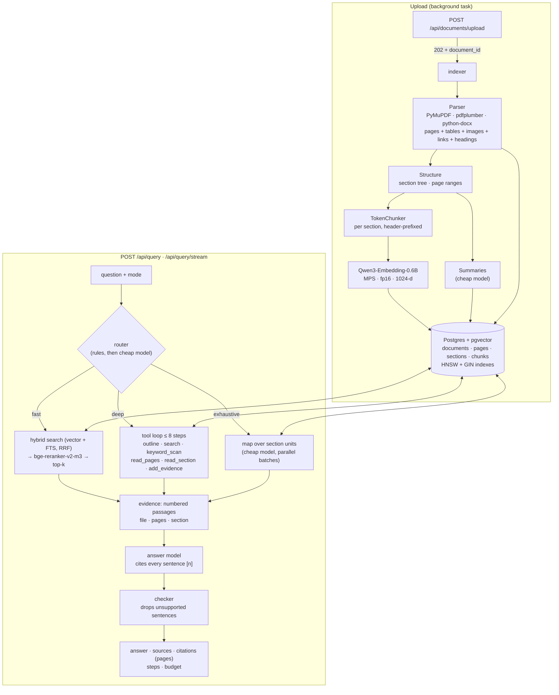

<div align="center">

# 🧠 DocMind

**Agentic RAG backend for long documents: structure-aware indexing, bounded research agents, page-cited answers checked against their evidence.**

   

</div>

## Highlights

| | |
|:--|:--|
| 🤖 **Agentic retrieval** | Four query modes. `fast` does one retrieval pass. `deep` runs a bounded tool loop (outline, search, keyword scan, read pages/sections). `exhaustive` map-reduces over every section. `auto` picks one. |
| 📑 **Structure-aware indexing** | Pages, a section tree (from the PDF outline or detected headings), section and document summaries, and chunks that never cross a section boundary |
| 📍 **Page-level citations** | Answers cite `[n]` evidence; every citation carries file, page range, section path and quote |
| ✅ **Checked answers** | A checker model removes sentences the evidence doesn't support, and the API reports what it removed |
| 🔎 **Hybrid retrieval** | pgvector HNSW cosine search + PostgreSQL full-text search, fused with **Reciprocal Rank Fusion**, 50 candidates reranked by `bge-reranker-v2-m3` |
| 🍎 **Strong local models** | `Qwen3-Embedding-0.6B` (1024-d) and `bge-reranker-v2-m3`, both on the Mac GPU (MPS) in fp16 |
| ⚡ **Streaming** | `POST /api/query/stream` emits `mode`, one `step` per agent action, `sources`, `token`s, `citations`, `done` |
| 🧪 **Tested + measured** | 60 unit tests (chunker, structure, tools, agent loop with a mocked LLM) and `scripts/eval.py` for page recall and citation accuracy |

## How it was built

Designed and directed by me; implemented with **Claude Code** as a pair programmer. The architecture decisions, trade-offs and the debugging story are written up in [Challenges & How I Solved Them](#challenges--how-i-solved-them-with-my-pair-programmer-claude-code-) below.

**Backend only.** The UI lives in my [portfolio](https://www.viral-deshle.cloud/docmind). This branch is a local demo: authentication, multi-tenancy and rate limiting are intentionally out of scope.

---

## Table of Contents

- [What It Does](#what-it-does)
- [Architecture](#architecture)
- [Query Modes](#query-modes)
- [Tech Stack](#tech-stack)
- [API Reference](#api-reference)
- [Project Structure](#project-structure)
- [Environment Variables](#environment-variables)
- [Running Locally](#running-locally)
- [Database Schema](#database-schema)
- [Key Design Decisions](#key-design-decisions)
- [Tests and Evaluation](#tests-and-evaluation)
- [What's Built](#whats-built-feature-status)
- [Challenges & How I Solved Them](#challenges--how-i-solved-them-with-my-pair-programmer-claude-code-)

---

## What It Does

1. **Ingest (in the background).** Upload returns `202` at once, and you poll `/status` while DocMind:
   - extracts per-page text with tables (as Markdown), image descriptions (vision LLM, capped per document) and hyperlinks
   - builds a **section tree** from the PDF outline, from font sizes when there is no outline, or from DOCX heading styles / markdown headings
   - splits each section into **token-sized chunks** (never mid-word, never across sections), each with a `Document / Section path` header
   - embeds header + text with **Qwen3-Embedding**, stores pages, sections and chunks in Postgres
   - writes **section and document summaries** with a cheap model

2. **Route.** `mode=auto` sends direct lookups to `fast`, multi-step questions to `deep` and "list everything" questions to `exhaustive`.

3. **Research.**
   - `fast`: hybrid search → rerank → top-k
   - `deep`: a planner model calls tools for at most 8 steps within a token and time budget, keeping passages as evidence
   - `exhaustive`: the cheap model reads every section in parallel batches and extracts verbatim findings

4. **Answer and check.** The answer model sees only the collected evidence, numbered `[1]…[n]`, and must cite every factual sentence. A checker removes unsupported sentences. The response includes the answer, sources, page-level citations, agent steps and the budget spent.

---

## Architecture



Streaming sends the same pipeline as Server-Sent Events: `mode` → `step`… → `sources` → `token`… → `citations` → `done`. In `fast` mode tokens stream live. In `deep` and `exhaustive` the answer is checked before it is sent.

---

## Query Modes

| Mode | What it does | Good for | Cost |
|---|---|---|---|
| `fast` | Hybrid search (50 candidates) → cross-encoder rerank → top-k → streamed answer | "What is the CFO's name?" | 1 LLM call |
| `deep` | Planner calls tools: `outline`, `search`, `keyword_scan`, `read_pages`, `read_section`, `add_evidence`, `finish` | "How did costs change and why?", "What does section 4.2 say about X?" | ≤ 8 tool calls + answer + check |
| `exhaustive` | Sections packed into ≤ 48 units of ~3k tokens; the cheap model extracts quoted findings from each, 6 at a time | "List every risk factor", "Summarize the whole report" | ≤ 8 batches + answer + check |
| `auto` | Rules catch clear cases ("list all…", "compare…", "section 3.1"); the cheap model decides the rest | Default | +0–1 small call |

All agent modes share one budget: `AGENT_MAX_STEPS` (8), `AGENT_TOKEN_BUDGET` and `AGENT_TIME_LIMIT_S`. When it runs out, the agent stops and answers from what it has, and the stream says why.

---

## Tech Stack

| Layer | Technology |
|---|---|
| Runtime | Python 3.11+, FastAPI (async) |
| Answer / planner LLM | OpenRouter → `anthropic/claude-sonnet-4.5` (`OPENROUTER_MODEL`) |
| Cheap LLM | OpenRouter → `anthropic/claude-haiku-4.5` (`FAST_MODEL`): summaries, routing, map step, checker |
| Embeddings | `Qwen/Qwen3-Embedding-0.6B`, 1024 dims, query instruction prompt, MPS + fp16 |
| Reranking | `BAAI/bge-reranker-v2-m3` cross-encoder, MPS + fp16 |
| Vector store | PostgreSQL 16 + `pgvector` (HNSW, cosine) + GIN full-text index |
| ORM | SQLAlchemy 2.x (async) + `asyncpg` |
| PDF parsing | `pymupdf` (text, outline, fonts, images, links) + `pdfplumber` (tables) |
| DOCX parsing | `python-docx` (heading styles, tables, images, links) |
| Fallback parser | `unstructured` |
| Config | `pydantic-settings` (`.env`) |

---

## API Reference

| Method | Endpoint | Description |
|---|---|---|
| `POST` | `/api/documents/upload` | Store a file and index it in the background → `202 {document_id, status: "processing"}` |
| `GET` | `/api/documents/{id}/status` | `processing` (stage: parsing / structuring / embedding / summarizing), `ready` or `failed` |
| `GET` | `/api/documents/{id}/outline` | Section tree with page ranges and summaries |
| `GET` | `/api/documents/{id}/pages/{n}` | Text of one page |
| `GET` | `/api/documents` | All documents with status and chunk counts |
| `GET` | `/api/documents/{id}/chunks` | All chunks with page ranges and section paths |
| `DELETE` | `/api/documents/{id}` | Delete a document and everything derived from it |
| `POST` | `/api/query` | Ask a question (`mode`: auto / fast / deep / exhaustive) |
| `POST` | `/api/query/stream` | Same, as SSE |
| `GET` | `/health` | Liveness check |
| `GET` | `/api/status` | Uptime, models, config, DB connectivity, `reindex_required` |

Interactive docs: `http://localhost:8000/docs`.

### Upload and wait

```bash
curl -F "file=@annual-report.pdf" http://localhost:8000/api/documents/upload
# {"document_id": "3fa85f64-…", "filename": "annual-report.pdf", "chunk_count": 0, "status": "processing"}

curl http://localhost:8000/api/documents/3fa85f64-…/status
# {"status": "processing", "stage": "embedding", "page_count": 212, "section_count": 64, "chunk_count": 0, …}
```

### Ask a question

```bash
curl -X POST http://localhost:8000/api/query \
  -H "Content-Type: application/json" \
  -d '{"query": "How did steel costs change and why?", "mode": "auto"}'
```

```json
{
  "answer": "Steel costs rose 8% in 2024 [2], driven by supplier price increases in Q3 [3].",
  "mode": "deep",
  "mode_reason": "needs multi-step reading or comparison",
  "steps": [
    {"n": 1, "tool": "outline", "args": {"document": "D1"}, "summary": "outline of D1: 64 sections"},
    {"n": 2, "tool": "read_section", "args": {"section": "S17"}, "summary": "read section “4 Finance > 4.2 Costs”"},
    {"n": 3, "tool": "add_evidence", "args": {"passages": ["P2", "P3"]}, "summary": "kept P2, P3 as evidence"},
    {"n": 3, "tool": "check", "args": {}, "summary": "checked answer: removed 0 unsupported sentence(s)"}
  ],
  "citations": [
    {"marker": 2, "filename": "annual-report.pdf", "page_start": 44, "page_end": 44,
     "section_path": "4 Finance > 4.2 Costs", "quote": "Steel costs rose 8%…", "document_id": "…"}
  ],
  "sources": [{"marker": 1, "text": "…", "page_start": 43, "page_end": 43, "section_path": "…", "filename": "…", "…": "…"}],
  "removed_claims": [],
  "budget": {"steps": 3, "tokens": 18450, "seconds": 9.8},
  "latency_ms": 11230.4
}
```

| Field | Type | Default | Description |
|---|---|---|---|
| `query` | string | required | Natural-language question |
| `document_ids` | string[] | null | Restrict to these documents (null = all) |
| `mode` | `auto` / `fast` / `deep` / `exhaustive` | `auto` | Research strategy |
| `k` | int 1–10 | 5 | Passages sent to the LLM in `fast` mode |

---

## Project Structure

```
doc-mind-backend/
├── scripts/
│   ├── reindex.py                  # re-embed all chunks after a model/dimension change
│   ├── eval.py                     # page recall + citation accuracy on a long PDF
│   └── eval_questions.example.json
├── src/
│   ├── main.py                     # app, lifespan (DB init, model warm-up), routers
│   ├── config.py                   # all settings (.env at repo root or src/)
│   ├── api/
│   │   ├── documents.py            # upload (202), status, outline, pages, chunks, delete
│   │   └── query.py                # /query and /query/stream (SSE)
│   ├── db/database.py              # documents, pages, sections, chunks; init_db()
│   ├── models/schemas.py           # request/response models
│   └── services/
│       ├── parser.py               # pages + headings from PDF / DOCX / TXT
│       ├── structure.py            # section tree, page mapping, section-aware chunking
│       ├── chunker.py              # token-aware chunker (never cuts words)
│       ├── embedder.py             # Qwen3-Embedding on MPS/CUDA/CPU (or Voyage)
│       ├── devices.py              # device + fp16 selection
│       ├── summarizer.py           # section / document summaries
│       ├── indexer.py              # background indexing with status updates
│       ├── retrieval.py            # hybrid search + bge reranker
│       ├── vector_store.py         # all SQL: writes, search, outline, pages, keyword scan
│       ├── llm.py / llm_client.py  # OpenRouter client with timeouts; chat() with tool calls
│       ├── rag_pipeline.py         # mode orchestration, SSE events, QueryResponse
│       └── agent/
│           ├── router.py           # auto → fast / deep / exhaustive
│           ├── tools.py            # tool specs + implementations
│           ├── deep.py             # bounded tool loop
│           ├── exhaustive.py       # map-reduce over sections
│           ├── answer.py           # evidence prompt, checker, citations
│           ├── store.py            # DocStore interface + Postgres implementation
│           └── workspace.py        # passages, evidence, budget
└── tests/                          # 60 tests; fakes.py has an in-memory store + scripted LLM
```

---

## Environment Variables

Copy `.env.example` to `.env` (repo root or `src/`). The main ones:

| Variable | Default | Description |
|---|---|---|
| `OPENROUTER_API_KEY` | — | **Required.** From [openrouter.ai/keys](https://openrouter.ai/keys) |
| `OPENROUTER_MODEL` | `anthropic/claude-sonnet-4.5` | Planner and answer model (must support tool calls for `deep`) |
| `FAST_MODEL` | `anthropic/claude-haiku-4.5` | Summaries, routing, map step, checker |
| `DATABASE_URL` | local postgres | asyncpg connection string |
| `LOCAL_EMBEDDING_MODEL` | `Qwen/Qwen3-Embedding-0.6B` | Any sentence-transformers model |
| `EMBEDDING_DIM` | `1024` | Must match the model. Change → run `scripts/reindex.py` |
| `EMBEDDING_DEVICE` / `RERANKER_DEVICE` | `auto` | `auto` picks MPS, then CUDA, then CPU |
| `EMBEDDING_FP16` / `RERANKER_FP16` | `true` | Applied on GPU only |
| `CROSS_ENCODER_MODEL` | `BAAI/bge-reranker-v2-m3` | Reranker |
| `CHUNK_SIZE` / `CHUNK_OVERLAP` | `400` / `60` | Tokens (embedding tokenizer) |
| `RETRIEVAL_K` / `TOP_K` | `50` / `5` | Candidates reranked / passages kept in fast mode |
| `HNSW_EF_SEARCH` | `100` | HNSW search breadth |
| `AGENT_MAX_STEPS` | `8` | Tool calls (deep) or map batches (exhaustive) |
| `AGENT_TOKEN_BUDGET` | `120000` | Prompt + completion tokens per question |
| `AGENT_TIME_LIMIT_S` | `120` | Wall-clock limit per question |
| `EXHAUSTIVE_MAX_UNITS` / `EXHAUSTIVE_UNIT_TOKENS` | `48` / `3000` | Map step size |
| `VERIFY_ANSWERS` | `true` | Run the checker in deep / exhaustive |
| `SUMMARIZE_SECTIONS` | `true` | Write summaries at upload |
| `EXTRACT_IMAGES` / `MAX_VISION_IMAGES` | `true` / `20` | Vision descriptions, capped per document |
| `LLM_TIMEOUT_S` / `LLM_MAX_RETRIES` | `60` / `2` | Per LLM request |

See `src/config.py` for the full list.

---

## Running Locally

**Prerequisites:** Python 3.11+, PostgreSQL with pgvector (`docker-compose up postgres -d` starts one on port 5433, or `brew install postgresql@17 pgvector`). On a Mac with Apple Silicon both models run on the GPU. The first start downloads about 3.5 GB of model weights.

```bash
python -m venv .venv && source .venv/bin/activate
pip install -r requirements.txt
cp .env.example .env              # set OPENROUTER_API_KEY and DATABASE_URL

cd src
uvicorn main:app --reload --port 8000
```

### Upgrading an existing database

Older databases hold 384-d MiniLM vectors. Startup no longer wipes them. Instead `/api/status` reports `reindex_required: true` and uploads return 409 until you run:

```bash
python scripts/reindex.py          # retype the column, re-embed every chunk, rebuild HNSW
```

Documents indexed before this branch still work in every mode. They have no pages or sections, so deep mode relies on search and keyword scan for them. Re-upload them to get the full structure.

---

## Database Schema

```sql
documents (id, filename, file_type, page_count, uploaded_at, file_key, file_url,
           status, stage, error, summary, has_real_pages)

pages     (id, document_id → documents, page_number, text)          -- GIN FTS index on text

sections  (id, document_id → documents, parent_id → sections, ordinal, level,
           title, path, page_start, page_end, body, summary)

chunks    (id, document_id → documents, chunk_index, text, embedding vector(1024),
           start_char, end_char, page_start, page_end,
           section_id → sections, section_path, header, created_at)

CREATE INDEX ix_chunks_embedding_hnsw ON chunks USING hnsw (embedding vector_cosine_ops)
    WITH (m = 16, ef_construction = 64);
CREATE INDEX ix_chunks_text_gin ON chunks USING GIN (to_tsvector('english', text));
```

`init_db()` creates tables and adds new columns idempotently on startup.

---

## Key Design Decisions

### Retrieval alone can't answer questions about a whole long document
Top-k retrieval is good at "find the paragraph that says X". It cannot answer "list every obligation", "compare chapter 2 with chapter 7" or "what does section 4.3 say" when the answer is spread out or the wording doesn't match. Deep mode lets a model navigate the document the way a person would: look at the outline, search, scan for exact terms, read whole pages or sections. Exhaustive mode stops guessing and reads everything, with a cheap model and a hard cap.

### Bounded agents
Every agent run has three limits (steps, tokens, seconds), and every action is visible as a `step` event. When a limit is hit, the agent answers from what it has and says why. It never loops forever or burns an unbounded bill.

### Evidence-only answers, then a checker
The answer model never sees raw search results, only the evidence the agent kept, numbered `[n]`. A second, cheaper model reads the answer sentence by sentence and flags anything the evidence doesn't support. Those sentences are removed and returned in `removed_claims`, so you can see what was dropped.

### Structure is captured once, at upload
Headings, page boundaries and summaries are computed once when the document is indexed, not on every question. That keeps citations precise (page ranges come from the stored page offsets) and lets the outline tool answer "where is X discussed?" without reading the document.

### Chunks carry their context
Every chunk is embedded and reranked as `Document: … / Section: A > B` plus its text. A paragraph that only says "the limit is 30 days" can then match a question about the *refund* limit, because its section path says "Refunds".

### HNSW, 50 candidates, a strong reranker
HNSW needs no training step, so recall stays good on a small or brand-new table (IVFFlat with `lists=100` on a few hundred rows returns poor neighbours). A 50-candidate pool gives `bge-reranker-v2-m3` room to find the real top 5.

### Hybrid search + RRF
Vector search misses exact terms (codes, names, numbers) and full-text search misses paraphrases. Both arms run and their rankings are fused with Reciprocal Rank Fusion: `score = Σ 1/(60 + rank + 1)`.

### Explicit reindexing
Changing the embedding model used to wipe all vectors silently at startup. Re-embedding is now a deliberate `scripts/reindex.py` run, so a config typo can't destroy the index.

---

## Tests and Evaluation

```bash
python -m pytest -q        # from the repo root; no database, GPU or API key needed
```

The agent tests run against an in-memory `FakeStore` and a scripted LLM (`tests/fakes.py`). They cover the tool-call protocol, step and token limits, auto-kept evidence, map-reduce batching, router rules, checker sentence removal, citation mapping, and a full deep-mode run through the SSE pipeline.

**Evaluation on a real long PDF** (server running):

```bash
python scripts/eval.py --pdf annual-report.pdf --questions my_questions.json --out eval.json
```

`my_questions.json` lists questions with the pages that answer them (see `scripts/eval_questions.example.json`). For each mode the script reports:
- **page recall**: share of the expected pages that the answer cites
- **citation accuracy**: share of citations whose quote really appears on the cited pages
- average steps and latency

---

## What's Built (Feature Status)

| Feature | Status |
|---|---|
| PDF / DOCX / TXT / MD ingestion with tables, images, links | ✅ |
| Per-page storage and page-range citations | ✅ |
| Section tree (PDF outline → font-size headings → page groups) | ✅ |
| Section + document summaries | ✅ |
| Token-aware, section-bounded chunking with headers | ✅ |
| Background indexing with status endpoint | ✅ |
| Qwen3-Embedding + bge-reranker-v2-m3 on MPS (fp16) | ✅ |
| HNSW vector index + FTS hybrid search (RRF) | ✅ |
| Query modes: auto / fast / deep / exhaustive | ✅ |
| Bounded tool loop (steps, tokens, time) | ✅ |
| Map-reduce over sections | ✅ |
| Evidence-only answers + unsupported-claim checker | ✅ |
| SSE step events | ✅ |
| Explicit reindex script | ✅ |
| Unit tests + eval script | ✅ |
| Optional Cloudflare R2 file storage | ✅ |
| Authentication, multi-tenancy, rate limiting | ⬜ out of scope (local demo) |

---

## Challenges & How I Solved Them with my Pair Programmer, Claude Code !

This section documents the real decisions and failures encountered while building DocMind — not just bugs, but design choices that evolved through observation, testing, and iterating on actual LLM behaviour.

---

### 1. Plain text extraction wasn't enough — built Phase 2 parsing

The first version of the parser extracted only text using `pypdf` and `python-docx`. Real documents are not just paragraphs — they contain tables with structured data, charts, and hyperlinks.

When users asked questions like "what was Q3 revenue?" or "what does the diagram show?", retrieval either failed completely or returned chunks that mentioned a table existed without containing its data.

**What we built:**
- **Tables** — `pdfplumber` extracts table cells per PDF page; `python-docx` reads table rows natively. Both serialised to Markdown (`| col | col |`) so the LLM reasons over values accurately.
- **Images** — `pymupdf` extracts embedded image bytes; each image is sent to Claude's vision API concurrently via `asyncio.gather` and embedded inline as `[IMAGE 1 | Page 3]: <description>`.
- **Hyperlinks** — `pypdf` walks `/Annots` objects for URI actions; `python-docx` reads `w:hyperlink` elements from the XML.

Everything is assembled into one enriched text string that the chunker and embedder consume without modification. Tables and image descriptions become fully searchable.

---

### 2. Vector search alone missed exact matches — moved to hybrid search

Pure semantic (vector) search excels at paraphrases but silently fails on exact terms — product codes, names, numbers, technical identifiers. Pure lexical search has the opposite problem.

**Solution:** Hybrid search combining both arms, fused with **Reciprocal Rank Fusion (RRF)**:

```
Vector arm   → top-N by cosine ANN  (pgvector IVFFlat index)
Lexical arm  → top-N by ts_rank_cd  (PostgreSQL GIN index + websearch_to_tsquery)
RRF fusion   → score = Σ 1 / (60 + rank + 1)  across both arms
```

RRF is rank-based, not score-based — it handles the fact that cosine similarity and BM25 scores live on completely different scales. A chunk that ranks #1 in both arms gets the highest fused score regardless of what the raw numbers were.

---

### 3. The system prompt went through multiple iterations — each driven by a real observed failure

The system prompt was not designed upfront. It was refined each time the LLM produced a wrong or unsafe output. Here is the exact sequence:

**Iteration 1 — Initial prompt (too basic)**

The prompt said: `Always cite the source chunk index (e.g., [Chunk 3]).`

`[Chunk 3]` means nothing to a user — it exposes a pipeline implementation detail. Removed chunk citations entirely, replaced with filename citations: `(report.pdf)`.

**Iteration 2 — Static rejection string**

The prompt had a hardcoded fallback: `"I don't have enough information in the provided documents."`

This fired even on partial matches, cutting off useful partial answers. Replaced with an open-ended instruction — answer what you can, state what is missing, suggest a rephrased question.

**Iteration 3 — No negative constraints → LLM went out of scope**

When asked *"Write code to find if a number is prime"*, the LLM correctly said the documents didn't contain it — then added: *"I can write one for you."* It slipped into being a general-purpose assistant.

The prompt only said what to do. Added an explicit **Hard scope limits** block:
```
- Do NOT write, generate, or produce any content not derived from uploaded documents.
- Do NOT offer to generate something as an alternative when documents lack the answer.
- Do NOT act as a general-purpose assistant.
```

**Iteration 4 — Identity confusion from retrieved context**

With a resume uploaded, asking *"Who are you?"* retrieved chunks like *"I'm Viral Deshle, a full-stack developer..."* — and the LLM answered as the person in the document. The system prompt instruction about identity couldn't compete with a strongly relevant retrieved chunk.

System prompt instructions cannot reliably override retrieved context. Fixed structurally with a **pre-retrieval meta-query guard**:

```python
if _is_meta_query(query):   # "who are you", "what can you do", "hello", etc.
    return QueryResponse(answer=_DOCMIND_INTRO, sources=[], ...)
```

No retrieval runs. No context is built. Response is deterministic every time.

**Result — the final system prompt has three layers:**
1. Positive instructions (what to do, how to cite, how to handle tables and images)
2. Hard negative constraints (what never to do under any circumstance)
3. Fallback guidance (how to respond when documents don't cover the question)

---

### 4. Sending too many chunks to the LLM was expensive and noisy

The frontend was passing `k=12` and all 12 chunks went to the LLM context. Two problems:

- **Cost:** 12 chunks × ~512 chars each × query volume adds up fast in token billing.
- **Quality:** Lower-ranked chunks (positions 8–12) are tangentially related at best. Sending them introduces noise that dilutes the answer.

The cross-encoder reranker made this worse — it was reranking a pool of 12 to return 12. The reranker's value is precision, not recall. It needs more candidates than the final answer requires.

**Solution — split `retrieval_k` from `context_k`:**

```
RETRIEVAL_K = 12   →  hybrid search fetches 12 candidates
                   →  cross-encoder reranks all 12  (large pool = better precision)
                   →  truncate to top 5
TOP_K = 5          →  only the 5 best chunks go to the LLM
```

The reranker now does its best work sorting 12 to find the true top 5. The LLM only sees the highest-confidence chunks. Token cost drops ~60% for equivalent or better answer quality.

---

### 5. Scores showing as ~1.6% — misleading but technically correct

After hybrid search was wired in, the API showed `"similarity": 0.016` on every result. It looked like retrieval was broken — scores near zero suggest completely unrelated content.

Real cause: the `similarity` field had been repurposed to carry the **RRF fusion score**, not cosine similarity. An RRF score for rank 0 with k=60 is always `1/(60+0+1) = 0.0163`. Correct score, wrong field name.

**Fix:** Renamed `similarity` → `score` across the Pydantic schema, all internal dicts, and logging. The API contract now accurately describes what the number represents.

When a pipeline change repurposes a field's semantics, rename it immediately. A misleading field name in a public schema propagates confusion to every consumer — frontend, tests, logs, and future developers.

---

### 6. Missing route discovered by the frontend in production — 404 on chunks

The frontend called `GET /api/documents/{id}/chunks` to display indexed content. The backend returned 404 — the route had never been defined.

Fix was straightforward: add the schema, DB query, and route. The deeper lesson: when building a backend-only API where the frontend is a separate project, route gaps are invisible until the frontend exercises them. The fix also surfaced a FastAPI subtlety — `GET /documents/{id}/chunks` must be registered **before** `DELETE /documents/{id}`, otherwise FastAPI captures `chunks` as the `document_id` path parameter and the wrong handler runs.

---

### 7. `text().label()` crashed SQLAlchemy — a surprisingly common pitfall

When the PostgreSQL full-text search rank expression was written as:

```python
text("ts_rank_cd(to_tsvector('english', chunks.text), ...)").label("fts_rank")
# ❌ NotImplementedError
```

`text()` returns a `TextClause` — an opaque SQL string SQLAlchemy cannot introspect. It has no concept of column labels or ordering.

**Fix:** `func.*` constructs return proper `ColumnElement` objects that support `.label()`, `.desc()`, and operator composition. User query bound via `bindparam()` to prevent SQL injection:

```python
func.ts_rank_cd(
    func.to_tsvector(literal_column("'english'"), Chunk.text),
    func.websearch_to_tsquery(literal_column("'english'"), bindparam("fts_query", value=query))
).label("fts_rank")
```

Rule of thumb: use `text()` only for SQL fragments that never need to be composed further. Use `func.*` for anything that participates in the expression API.
